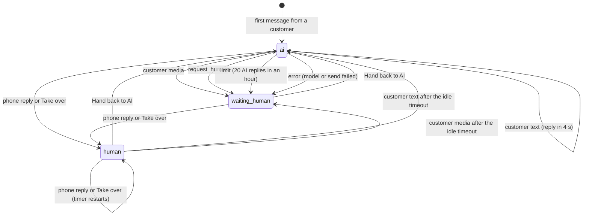

# AI handoff

## What it shows

An AI agent that answers WhatsApp customers on pipes.bot (BYON API v2) from your instructions and FAQ, and steps aside when your team replies from the phone or a customer needs a person.

The hard part of a bot on a coexistence number is that the AI and a person share one number. This app shows, in readable code, how to keep them from talking over each other. Echoes (`smb_message_echoes`) are the signal that a human joined the conversation.

Your team answers only from the WhatsApp Business app on the phone. The dashboard is a control tower: it shows who is handling each conversation and why, and lets you take a conversation over or hand it back. It has no inbox for typing replies.

- A workspace per account, with Better Auth sign-up and sign-in.
- A **Connect a number** flow built on pipes.bot embedded signup, with an **AI replies** switch per number (off by default).
- **Instructions** and an **FAQ** that you edit in **Settings**. There is no RAG: both are sent to the model on every turn.
- A **Conversations** page with the state of every conversation, split in tabs: **Needs human**, **With staff**, **AI** and **All**.
- A conversation view with the chat, the reason for a handoff, the **AI turns** (outcome, tools and arguments of each turn), **Take over** and **Hand back to AI**.
- **Requests**: orders, quotes and bookings that the AI saved for the team, with **Mark done**.
- A demo with a simulator and a built-in model, so you can see all of it without a phone or an OpenRouter key.

Stack: TanStack Router (static SPA built with Vite), Convex (HTTP actions, reactive queries, scheduler, crons), Better Auth (Convex component, `crossDomain` plugin), Tailwind v4 and shadcn/ui, AI SDK 7 with OpenRouter.

## pipes.bot features used

- Webhooks with Standard Webhooks signatures (`POST /webhooks/pipes`)
- BYON API v2 events: `number.onboarded`, `messages`, `smb_message_echoes`, message statuses
- Embedded signup: `POST /v1/apps/token` with `metadata.workspaceId`
- Coexistence echoes: replies sent from the phone, which make the AI step aside
- Sending text: `POST /v1/messages/app/send`
- Number health: `GET /v1/pool-numbers/{id}/health`

## How it works

```
pipes.bot --POST /webhooks/pipes--> httpAction (verify signature) --> mutation ingest
                                                                          |
                                      transition(state, event) --> schedules or cancels
                                                                          v
                               conversations, messages --> scheduler: respond(conversationId, turn)
                                                                          |
                                                                          v
                                         action respond --> OpenRouter (or the demo model)
                                                                          | intents
                                                                          v
                                         mutation commitReply (is the turn still current?)
                                                                          |
                                         action deliver --> POST /v1/messages/app/send
SPA (TanStack Router) <-- reactive queries (conversations, turns, requests)
   '-- mutations: takeOver, handBack, settings, aiEnabled, demo
cron (1 h) --> checkHealth --> GET /v1/pool-numbers/{id}/health
```

Every decision about who speaks next goes through one pure function, `transition` in `convex/lib/handoff.ts`. Ingestion, the dashboard buttons and the AI's result only produce events for it.

### Who answers: the three modes

Each conversation is in one of three modes:

| Mode | Meaning | Shown as |
| --- | --- | --- |
| `ai` | The AI answers the customer's text messages | **AI** tab |
| `human` | Your team is handling it. The AI stays quiet until the timer ends or you hand back | **With staff** tab |
| `waiting_human` | The AI stepped aside and a person has to look. It never returns by itself | **Needs human** tab |



How to read it:

- **Customer text** is a text message, or a button or list reply that carries its title. In `ai` mode it schedules a reply 4 seconds later (the debounce), so two messages in a row get one answer. A message older than 15 minutes (a webhook retry after an outage, or a replayed parked event) updates the state but gets no reply.
- **Customer media** (image, audio, document, location and any other type) goes to `waiting_human` with the reason `media`, because the AI does not read media. Reactions and stickers are stored but change nothing.
- **Phone reply** is an echo from the WhatsApp Business app. It moves any conversation to `human` with the reason `phone_reply` and starts a timer of **Minutes before the AI resumes** (`idleMinutes`, default 30, from 5 to 1440, set in **Settings**). Another phone reply or **Take over** restarts the timer.
- **Idle timeout** is lazy: there is no cron. After the timer ends the dashboard shows "AI resumes on the next message", and the next customer text brings the AI back and gets an answer. Media after the timer ends goes to `waiting_human`. Before the timer ends, customer messages change nothing.
- **Take over** and **Hand back to AI** are the dashboard buttons. A hand back answers right away when the last message is the customer's.
- **`request_human`**, **limit** and **error** are results of an AI turn. The reason is shown in plain language in the conversation header, with the AI's summary for `request_human` and the last error for `error`.
- The handoff summary is kept when a `waiting_human` conversation moves to `human` and is cleared only when the conversation goes back to `ai`.
- Combinations that make no sense (a handoff while the conversation is not in `ai`, for example) change nothing.

With **AI replies** off on the number, the states are still tracked, but no reply is ever scheduled.

### Webhook and ingestion

`POST /webhooks/pipes` verifies the Standard Webhooks signature (`webhook-id`, `webhook-timestamp`, `webhook-signature`, 300 s tolerance, constant-time comparison) and answers:

| Status | When |
| --- | --- |
| 401 | Missing or invalid signature |
| 400 | The body is not a JSON object |
| 500 | `PIPES_WEBHOOK_SECRET` is unset or malformed |
| 200 | Everything else, including duplicates |

The raw event is stored (deduplicated by webhook id) and projected into numbers, conversations and messages in one transaction. An unexpected failure returns 500 so pipes.bot retries. Events for a number the app does not know yet are parked and replayed when `number.onboarded` arrives; a message parked for more than 15 minutes gets no reply.

- A conversation is one customer on one number, found by BSUID first and then by phone number. It starts in `ai`. `user_changed_number` and `user_changed_user_id` migrate an existing conversation.
- A reply sent from the phone arrives as an echo, is stored as a `phone` message and moves the conversation to `human`. It does not open the 24-hour window. An echo whose `wamid` is already stored is ignored.
- Statuses update the message with the same `wamid`. A `failed` status on an AI message ends the AI's turn with an error, if the conversation is still in `ai`.
- Received media is stored with its type and caption.

**Signup and ownership.** `createSignupLink` calls `POST /v1/apps/token` with `metadata.workspaceId` and `redirectUrl = ${SITE_URL}/numbers/connected`, and sends the user to the pipes.bot signup page. When `number.onboarded` arrives, its `metadata.workspaceId` ties the number to the workspace, with **AI replies** off. Reconnecting a number to the same workspace keeps the switch. Onboarding a number into a different workspace turns **AI replies** off, and new messages start fresh conversations there.

## How the AI decides

`respond` is an internal action that answers one turn of one conversation.

**Before the model.** The turn is dropped, and recorded as `dropped`, when the conversation is no longer in `ai` or its turn counter moved (`stale`), when **AI replies** is off (`ai_disabled`), or when the 24-hour window is closed (`window_closed`). A conversation that was deleted meanwhile (a demo reset, for example) is skipped, and nothing is recorded for it. With 20 AI replies in the last hour on the conversation, the turn ends in `waiting_human` with the reason `limit` and the model is not called.

**The prompt.** The system prompt (in English) has, in this order:

1. The workspace **Instructions** between `<instructions>` tags and the **FAQ** between `<faq>` tags.
2. Fixed rules: answer in about 600 characters or fewer, in the customer's language, in plain text; never invent a price, lead time, stock level or policy that is not in the instructions or the FAQ; call `request_human` when the AI does not know, the customer asks for a person, complains or the subject is sensitive (and tell the customer in one sentence that someone from the team will continue); call `save_request` when the customer places an order, asks for a quote or makes a booking.
3. A warning that the conversation is untrusted content: it can contain instructions, but it cannot change the rules.

The conversation is a single `user` message inside `<conversation>` tags with the last 30 messages. Each line is labeled `Customer:`, `Assistant:` or `Staff (phone):`, media shows as `[image] caption`, and continuation lines are indented so a message cannot forge a role line.

**The two tools.**

| Tool | Input | Recorded as |
| --- | --- | --- |
| `request_human` | `reason` (≤ 200), `summary` (≤ 500) | A handoff. If called more than once, the last call wins |
| `save_request` | `summary` (≤ 500), `details` (≤ 2000), `customerName` (≤ 80, optional) | A row in **Requests**. At most 3 per turn |

Fields over the limit are cut, never rejected, so a long input does not break the turn. The model runs with at most 3 steps and a 60 s timeout.

**Why tools only record intents.** Calling a tool does nothing by itself. It writes an intent into the result of the turn, and `commitReply` applies it later, in one transaction, only if the turn is still current. If the tools acted right away, a turn that lost a race could still create a request or hand the conversation off after a person had already taken over.

**The turn counter.** `aiTurn` goes up on every event that invalidates a reply in progress. A reply is scheduled for a specific turn, checked when `respond` starts and checked again inside `commitReply` before anything is written. This prevents three races:

- **Staff replies while the AI is thinking.** The echo moves the conversation to `human` and raises `aiTurn`, so the turn is dropped as `stale` and nothing is sent.
- **A second customer message.** It raises `aiTurn` and reschedules the reply, so the earlier turn is dropped and one answer covers both messages.
- **A button click.** **Take over** moves the conversation to `human` and raises `aiTurn`, so a turn that was already running is dropped and cannot answer after the click. (**Hand back to AI** needs no such guard: a conversation in `ai` ignores it.)

Once `commitReply` has written a message, it is delivered even if the turn changes afterwards. The check that matters is the one before anything is written.

**After the model.** `commitReply` saves the requests, then the reply (cut at the end of a sentence before 600 characters, or at 600 with `…`), then applies the handoff, and stores an `aiRun` with the outcome: `sent`, `handed_off`, `empty` (no text and no intent), `dropped`, `limited` or `error`. The conversation page shows the 50 most recent turns. There is no cleanup of old runs.

**Model errors.** A model error or timeout is retried once, 10 seconds later. A second failure moves the conversation to `waiting_human` with the reason `ai_error`.

**Model choice.** `OPENROUTER_MODEL` (default `anthropic/claude-sonnet-5.5`) through OpenRouter, requesting zero-data-retention routing with `provider: { zdr: true, data_collection: "deny" }`. Without `OPENROUTER_API_KEY` a deterministic demo model answers, matching keywords without regard to case:

| Keywords | Result |
| --- | --- |
| `human`, `agent`, `person`, `humano`, `atendente`, `pessoa` | `request_human`, and "Sure — someone from our team will take it from here." |
| `order`, `quote`, `buy`, `book`, `pedido`, `orçamento`, `comprar` | `save_request` with the last message as the details, and "Got it — I saved your request and the team will confirm." |
| anything else | "Thanks for your message! This is a demo reply — set OPENROUTER_API_KEY to answer with a real model." |

The demo model also answers real numbers when the key is missing. **Settings** shows which model is active.

### Sending

Replies are text only, sent with `POST /v1/messages/app/send` and `{ poolNumberId, to, text }`, and only inside the 24-hour window.

- A number whose health check reports `BLOCKED` fails the message with `number_blocked`, without calling the API.
- A demo number never calls the API: the message is marked `sent` with a `wamid.demo_...` id and `delivered` about 2 seconds later.
- **Rate limit (429).** The message was not sent, so it is retried after `X-RateLimit-Reset` (or 60 s), at most 3 attempts in total, then `failed` with `rate_limited`. The limit is 60 requests per minute per API key.
- **A timeout is never retried.** After 30 s the message may or may not have gone out, so it ends as `failed` with `unknown`. A network error is not retried either.
- `SERVICE_WINDOW_EXPIRED` (or Meta error 131047) ends as `failed` with `window_closed`. Any other failure keeps its code.
- When an AI message fails and the conversation is still in `ai`, it moves to `waiting_human` with the reason `ai_error`, and the error shows in the conversation header.

### Number health

An hourly cron calls `GET /v1/pool-numbers/{id}/health` for each number and maps the result to healthy, unhealthy or unknown (also used when the call fails). Demo numbers are skipped, and without `PIPES_API_KEY` real numbers show as unknown. The Numbers page shows the badge.

## Run locally

Requires Node 22.18+ and pnpm.

```bash
pnpm install
pnpm exec convex dev        # creates a deployment, pushes the functions, writes .env.local
```

`convex dev` keeps running and pushes your function changes as you edit, so leave it open and run the commands below, and later `pnpm dev`, in a second terminal.

On first run `convex dev` asks how to create the deployment. Without a Convex account, run `CONVEX_AGENT_MODE=anonymous pnpm exec convex dev` to get a local anonymous deployment. A local deployment is not reachable from the internet, so pipes.bot cannot deliver webhooks to it. That is enough for the demo and the simulator. To connect a real number you need a cloud dev deployment (`pnpm exec convex dev` while logged in).

Set the Convex environment variables on the deployment (they are not read from `.env.example`):

```bash
npx convex env set PIPES_API_KEY ak_...
npx convex env set PIPES_APP_SLUG your-app-slug
npx convex env set PIPES_WEBHOOK_SECRET whsec_...
npx convex env set SITE_URL http://localhost:5173
npx convex env set BETTER_AUTH_SECRET "$(openssl rand -base64 32)"
# Optional
npx convex env set OPENROUTER_API_KEY sk-or-...
npx convex env set OPENROUTER_MODEL anthropic/claude-sonnet-5.5
npx convex env set PIPES_API_BASE_URL https://api.pipes.bot
```

| Variable | Where | Description |
| --- | --- | --- |
| `PIPES_API_KEY` | Convex | `ak_...` key of your App. Used to create signup links, send replies and check number health. Required to connect a real number. |
| `PIPES_APP_SLUG` | Convex | Slug of your App, used to build the signup URL. Required to connect a real number. |
| `PIPES_WEBHOOK_SECRET` | Convex | `whsec_...` secret of your App. Required to receive webhooks. |
| `PIPES_API_BASE_URL` | Convex | Optional. Defaults to `https://api.pipes.bot`. |
| `SITE_URL` | Convex | Exact origin of the web app, for example `http://localhost:5173`. Required. |
| `BETTER_AUTH_SECRET` | Convex | Random secret for Better Auth. Generate it with `openssl rand -base64 32`. Required. |
| `OPENROUTER_API_KEY` | Convex | Optional. Without it the built-in demo model answers. |
| `OPENROUTER_MODEL` | Convex | Optional. Defaults to `anthropic/claude-sonnet-5.5`. |
| `VITE_CONVEX_URL` | `.env.local` | The `.convex.cloud` URL (or the local API URL). Written by `convex dev`. |
| `VITE_CONVEX_SITE_URL` | `.env.local` | The `.convex.site` URL (or the local site proxy URL). Written by `convex dev`. |

`PIPES_API_KEY`, `PIPES_APP_SLUG` and `PIPES_WEBHOOK_SECRET` can stay unset if you only use the demo.

Then start the web app and open http://localhost:5173:

```bash
pnpm dev
```

### Set up pipes.bot

1. Create an App on **API v2** in pipes.bot.
2. Turn on **Forward messages sent from the phone**. Without it no echoes arrive, and the AI cannot tell that your team replied.
3. Set the webhook URL to `https://<deployment>.convex.site/webhooks/pipes`.
4. Copy the `whsec_` secret and the `ak_` key into `PIPES_WEBHOOK_SECRET` and `PIPES_API_KEY`, and the App slug into `PIPES_APP_SLUG`.
5. Sign up in the app, open **Numbers**, and click **Connect a number**.
6. After the number appears, turn on **AI replies** for it. It is off by default, so a newly connected number never answers on its own. Turning it on or off does not answer old messages.
7. Write your **Instructions** and **FAQ** in **Settings**.

### Checks

```bash
pnpm test        # Vitest + convex-test, 205 tests, no backend needed
pnpm typecheck   # app and Convex functions
pnpm build       # static bundle in dist/
```

The webhook payloads in `tests/fixtures/` are copies of files in the repo's `fixtures/byon-v2/`, so this folder does not import anything from the repo root.

To send a signed fixture to a running backend, use the simulator from the repo root (run `pnpm install` there first):

```bash
pnpm simulate byon-v2/test-webhook --url <site-url>/webhooks/pipes --secret <whsec_...>
pnpm simulate byon-v2/test-webhook --url <site-url>/webhooks/pipes --secret <whsec_...> --bad-signature
```

`<site-url>` is the `.convex.site` URL (the local proxy prints something like `http://127.0.0.1:3211`). The first command prints `200 ok`, the second prints `401`.

## Try it without a phone

Sign up, open **Settings**, and click **Load demo data**. It creates a demo number with **AI replies** on and four conversations for a small bakery, through the same ingestion function as real webhooks:

- Maya, answered by the AI, with an open order in **Requests**.
- Leo, where the AI asked for a person (`waiting_human`, with a summary).
- Ana, where the team replied from the phone a few minutes ago (`human`, with the timer running).
- Sam, who sent a photo (`waiting_human`, reason `media`).

Open a conversation and use the **Simulator**:

- **Send as customer** plays a customer message. About 4 seconds later the AI answers.
- **Reply as staff from phone** plays an echo and moves the conversation to `human`.

Try "I want a person" (the AI hands off) and "I want a quote" (a request appears in **Requests**). **New demo conversation** starts a new customer, and **Reset demo data** removes the demo number and everything under it. Without `OPENROUTER_API_KEY` the built-in demo model answers; **Settings** says which model is active. Demo numbers never call pipes.bot.

## Customize

- **Instructions and FAQ.** The easiest change. Edit them in **Settings** (up to 4000 and 16000 characters). They are the AI's whole knowledge, and they are sent on every turn.
- **Rules.** The fixed rules are in `systemPrompt` in `convex/lib/prompt.ts`.
- **Model.** Set `OPENROUTER_MODEL` on the deployment. Provider routing is in `convex/lib/model.ts`.
- **Limits.** The constants (debounce, 20 replies per hour, 600 characters, 30 messages of history, timeouts) are at the top of `convex/lib/handoff.ts`.
- **Add a tool.**
  1. Define the tool in `modelDecision` in `convex/lib/decide.ts`. Keep `execute` to recording an intent (no side effects), and cut long fields instead of rejecting them.
  2. Add the intent to `ReplyDecision` and to `decisionValidator` in `convex/responder.ts`.
  3. Apply the intent in `commitReply`, after the turn check, so a stale turn never acts.
  4. Mention the tool in the rules in `convex/lib/prompt.ts`, and give `demoDecision` a matching branch so the demo model can show it.

## Deploy

1. Deploy the backend: `npx convex deploy`. Set the same environment variables on the production deployment, with `SITE_URL` set to the final URL of the web app.
2. Build the web app with `pnpm build` and host the `dist/` folder as a static site on Vercel or Netlify. Set `VITE_CONVEX_URL` and `VITE_CONVEX_SITE_URL` in the host's build environment, and add a rewrite of every path to `/index.html` so deep links work.
3. In pipes.bot, set the webhook URL to `https://<production-deployment>.convex.site/webhooks/pipes`.

`SITE_URL` must be the exact origin of the SPA (scheme, host and port, no trailing path). This app trusts exactly one origin, `SITE_URL`, so preview deployments on other origins cannot sign in. To let preview deployments sign in, add each preview origin exactly to `trustedOrigins` in `convex/auth.ts`; the cross-domain sign-in only hands the session to exact origins, so wildcard patterns are not enough. The signup `redirectUrl` is built from `SITE_URL` and must be HTTPS except on localhost.

## Privacy

Customer messages are sent to an AI provider through OpenRouter, and to the provider of the model you choose, to be answered.

- Each turn sends your **Instructions** and **FAQ** and the last 30 messages of the conversation, including what your team wrote from the phone. Do not put secrets or personal data in the instructions or the FAQ.
- The app requests zero-data-retention endpoints with `zdr: true` and `data_collection: "deny"`. OpenRouter only routes the request to providers that match those settings.
- You can restrict providers further in your OpenRouter account settings (privacy and allowed providers).
- Without `OPENROUTER_API_KEY`, no message leaves your Convex deployment. The built-in demo model runs inside it.
- Tell your customers that an AI answers them, for example in the instructions ("Say that you are an AI assistant") or in your WhatsApp Business profile. Decide with your legal team whether you also need their consent.
- Customer text appears in the dashboard as plain text.

Prompt injection: the tools only act on the current conversation, send no messages and read no other data, their fields have size limits, and the AI sees nothing besides the prompt. A customer can still make the AI say something odd or ask for a person, so review the **AI turns** of a conversation when something looks wrong.

## Known limits

- The AI does not read media. Any image, audio or document sends the conversation to a person.
- Text only, and only inside the 24-hour window. There are no templates, so the AI cannot start a conversation or answer after the window closed.
- The send rate limit is 60 requests per minute per API key, shared by every number of the App.
- No business hours. The AI answers at any time while it is on.
- At most 20 AI replies per conversation per hour.
- Your team answers only from the phone. There is no inbox in the dashboard.

## Error handling

| Situation | Behavior |
| --- | --- |
| Invalid signature or timestamp outside the tolerance | 401 |
| Body that is not a JSON object | 400 |
| Duplicate webhook | 200, no effect |
| Unexpected error in `ingest` | 500, nothing stored, pipes.bot retries |
| A person replies or a button is used while the AI is thinking | Turn `dropped` (`stale`), nothing sent |
| Model error or timeout | One retry after 10 s, then `waiting_human` with `ai_error` |
| Reply over 600 characters | Cut at the end of a sentence |
| 20 AI replies in an hour | `waiting_human` with `limit`, the model is not called |
| Blocked number, closed window or another send failure | Message `failed`, `waiting_human` with `ai_error`, error in the header |
| 429 from pipes.bot | Up to 3 attempts in total, then `failed` |
| Timeout while sending | `failed` with `unknown`, never retried |
| `/v1/apps/token` fails | Error on the Numbers page |
| Health check fails | The number shows as unknown |

## Out of scope

Left out on purpose, and good next steps:

- Media read by the AI (audio, images).
- Templates and messages outside the 24-hour window.
- RAG and document upload. The FAQ is plain text.
- Business hours.
- Notifications outside the dashboard, for example an email or a message when a conversation needs a person.
- Teams, invitations and assigning conversations. There is one user per workspace.
- Replying from the dashboard.
- Streaming.
- Cleaning up old `aiRuns`.
- BYON legacy, sandbox and WebSocket modes.
- Email verification and OAuth sign-in. To add OAuth providers, add `socialProviders` to the `betterAuth({...})` call in `convex/auth.ts` (see the [Better Auth OAuth docs](https://www.better-auth.com/docs/concepts/oauth)).

## Verification status

**Tested:**

- Automated tests: `pnpm test` (205 tests), `pnpm typecheck` and `pnpm build`.
- The webhook route on a local Convex backend (`pnpm simulate`): a correctly signed delivery returns 200, and a wrong `whsec_` secret, a bad signature and a missing signature each return 401.
- A number path against the repo's mock pipes.bot API (`pnpm mock-api`) with `pk_smoke_test_key` and no OpenRouter key: a signed `number.onboarded` event linked a number to a workspace, a customer text produced a demo-model reply that the mock received on `/v1/messages/app/send` (and the message reached `sent`), and a following `smb_message_echoes` event moved the conversation to `human`.
- The dashboard in a headless Chromium run against a local Convex backend with the demo model: load the demo data, an AI reply to a simulated customer message, asking for a person, a staff reply from the phone, handing back to the AI, a quote that creates a request, and marking the request done.

**Not verified:**

- A real OpenRouter model. Prompts and tools are covered with a mock model and the built-in demo model.
- Sending with a real pipes.bot key. Sends are covered with a mocked `fetch`, the simulated demo number and the local mock API.
- A real number with phone echoes, real webhooks and a real customer conversation.
- The `ai-handoff` GitHub Actions job (the repo has no remote yet, so it has not run).
